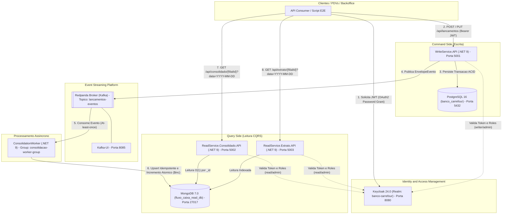
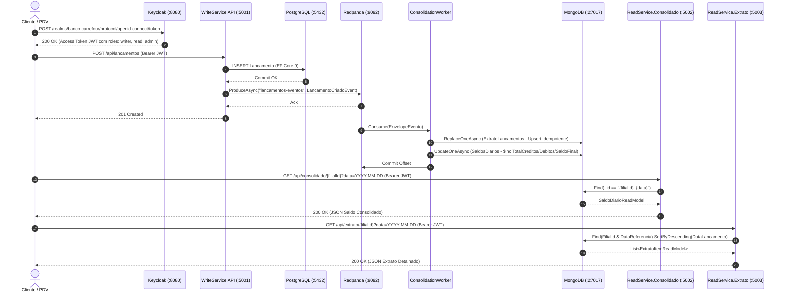

# 🏦 Banco Carrefour — Arquitetura de Fluxo de Caixa Distribuído (.NET 9 LTS)

Solução corporativa de engenharia de software para controle de lançamentos contábeis (Débito e Crédito) e consolidação diária de saldos por filial. O sistema foi projetado para alta disponibilidade, resiliência a picos de tráfego (50 requisições por segundo no consolidado diário com perda inferior a 5%) e desacoplamento total entre os contextos de escrita e leitura.

## 📚 Documentação Executiva e Arquitetural Complementar

Para aprofundamento técnico durante a avaliação, consulte os documentos detalhados na pasta [`docs/`](./docs):

1. **[📜 Catálogo de Contratos das APIs e Eventos (`docs/CONTRATOS_APIS.md`)](./docs/CONTRATOS_APIS.md):** Especificação completa dos endpoints REST (`POST`, `PUT`, `GET`), payloads JSON, códigos de retorno HTTP, matriz RBAC do Keycloak e schemas dos eventos do Redpanda/Kafka.
2. **[🏛️ Documento de Visão Arquitetural e ADRs (`docs/VISAO_ARQUITETURAL.md`)](./docs/VISAO_ARQUITETURAL.md):** Mapeamento de Requisitos Não-Funcionais (SLA de 50 req/s e isolamento de falhas), Modelo C4, Arquitetura Hexagonal e registo formal das decisões de engenharia (*Architecture Decision Records*).
3. **[📊 Apresentação Executiva — Defesa da Solução (`docs/APRESENTACAO_EXECUTIVA.md`)](./docs/APRESENTACAO_EXECUTIVA.md):** Material executivo estruturado em slides justificando o retorno técnico e financeiro da arquitetura escolhida, comparativo com abordagens monolíticas e plano de escala Cloud-Native.

## ✅ Matriz de Conformidade com o Documento do Case

| Requisito Oficial do Desafio | Status | Implementação e Comprovação Prática |
| :--- | :--- | :--- |
| **Controle de Lançamentos (Débito e Crédito)** | Atendido | `WriteService.API` (`POST` e `PUT /api/lancamentos`) com invariantes de domínio e PostgreSQL 16. |
| **Consolidação Diária de Saldos** | Atendido | `ConsolidationWorker` processando eventos via Redpanda e projetando no MongoDB (`SaldosDiarios` e `ExtratoLancamentos`). |
| **Indisponibilidade do Consolidado não afeta Lançamentos** | Atendido | Isolamento físico e assíncrono via **CQRS + Redpanda**. Validado automaticamente em `./test-nfr-case.sh` (para o consolidado e efetua `POST` retornando `201 Created`). |
| **Pico de 50 req/s no Consolidado com menos de 5% de perda** | Atendido | Leitura O(1) por chave composta `_id` em documento pré-agregado no MongoDB (`< 5ms`). Validado em `./test-nfr-case.sh` (50 requisições concorrentes com `0%` de perda). |
| **Segurança, Testes e Containerização** | Atendido | OAuth2/OIDC com **Keycloak 24** (`writer`, `read`, `admin`), testes `xUnit` e orquestração completa via `docker-compose.yml`. |

4. **[Modelo de Dados Poliglota - PostgreSQL & MongoDB (`docs/MODELO_DADOS.md`)](./docs/MODELO_DADOS.md):** DDL relacional, colecoes MongoDB, Decimal128 e indices compostos.
5. **[Especificacao de Topicos e Schemas Kafka/Redpanda (`docs/SCHEMAS_KAFKA.md`)](./docs/SCHEMAS_KAFKA.md):** Particionamento FIFO por FilialId, DLQ e contratos JSON Schema.

## 🏗️ 1. Visão Geral da Arquitetura

A plataforma combina **Arquitetura Hexagonal (Ports & Adapters)**, **Domain-Driven Design (DDD)**, **CQRS (Command Query Responsibility Segregation)** e **Event-Driven Architecture (EDA)**:

* **Command Side (`WriteService.API` — Porta `5001`):** Microsserviço em .NET 9 Minimal APIs dedicado à recepção, validação de invariantes de domínio e persistência transacional ACID de lançamentos no **PostgreSQL 16**, publicando eventos de domínio (`LancamentoCriadoEvent` e `LancamentoEditadoEvent`) no broker **Redpanda (Kafka-compatible)**.
* **Event Processor (`ConsolidationWorker`):** Worker assíncrono em .NET 9 (`BackgroundService`) que consome o tópico `lancamentos-eventos` com controle manual de *offset* (`EnableAutoCommit = false` e `AutoOffsetReset = Earliest`), garantindo entrega *at-least-once*, roteamento para *Dead-Letter Queue* (`lancamentos-dlq`) em falhas críticas e projeção atômica/idempotente no **MongoDB 7.0** utilizando `Decimal128` e `GuidRepresentation.Standard`.
* **Query Side (`ReadService.Consolidado.API` — Porta `5002` & `ReadService.Extrato.API` — Porta `5003`):** Microsserviços independentes de leitura otimizados para baixa latência (busca O(1) por chave composta `FilialId_Data` e índices compostos no MongoDB). Mesmo que o `WriteService` ou o PostgreSQL fiquem indisponíveis, as consultas de saldo diário e extrato permanecem 100% operacionais.
* **Segurança & Identidade (`Keycloak 24` — Porta `8080`):** Autenticação OAuth2 / OpenID Connect (OIDC) e autorização baseada em *Role-Based Access Control* (RBAC) com validação estrita de tokens JWT (`writer`, `read`, `admin`), preservação de claims originais (`MapInboundClaims = false`) e suporte multi-issuer (`localhost` e rede interna Docker).

### Diagrama de Arquitetura de Componentes



### Fluxo de Sequência Ponta a Ponta (End-to-End)



## 🛠️ 2. Stack Tecnológica e Decisões de Engenharia

| Camada | Tecnologia | Versão | Papel na Arquitetura |
| :--- | :--- | :--- | :--- |
| **Runtime & SDK** | .NET | 9.0 LTS | Alto throughput em Minimal APIs e baixo consumo de memória |
| **Banco de Escrita** | PostgreSQL + EF Core | 16-alpine / 9.0.0 | Garantia ACID no registro primário de lançamentos |
| **Mensageria** | Redpanda + Confluent.Kafka | v23.3.3 / 2.6.0 | Broker Kafka-compatible em C++ sem JVM e baixa latência |
| **Banco de Leitura** | MongoDB + MongoDB.Driver | 7.0 / 3.0.0 | Projeções CQRS com incremento atômico (`$inc`) e `Guid Standard` |
| **Segurança (IAM)** | Keycloak | 24.0 | Emissão de JWT OIDC e RBAC (`writer`, `read`, `admin`) |
| **Testes** | xUnit, FluentAssertions, NSubstitute | .NET 9 | Testes unitários de invariantes de domínio e aplicação |

## 📂 3. Estrutura do Monorepo

```text
├── docker/
│   └── keycloak-realm.json                  # Importação automática do Realm, Client e Roles no Keycloak
├── src/
│   ├── BuildingBlocks/
│   │   └── EventBus.Messages/               # Contratos de eventos partilhados (EnvelopeEvento, LancamentoCriado/Editado)
│   ├── WriteService/
│   │   ├── WriteService.Domain/             # Entidades ricas, Value Objects, Exceções de Domínio e Ports
│   │   ├── WriteService.Application/        # Casos de uso (LancamentoCommandService) e DTOs
│   │   ├── WriteService.Infrastructure/     # EF Core 9 (WriteDbContext) e KafkaEventProducer
│   │   └── WriteService.API/                # Minimal APIs, Autenticação JWT, RBAC e Dockerfile
│   ├── ConsolidationWorker/
│   │   ├── Worker.Domain/                   # Modelos de projeção (SaldoDiarioDocument, ExtratoLancamentoDocument)
│   │   ├── Worker.Application/              # ConsolidacaoProcessor (cálculo de deltas de criação e edição/estorno)
│   │   ├── Worker.Infrastructure/           # KafkaConsolidacaoWorker (DLQ + Commit manual) e MongoProjectionRepository
│   │   └── Worker.Host/                     # Inicialização do BackgroundService e Dockerfile
│   ├── ReadService.Consolidado/
│   │   └── ReadService.Consolidado.API/     # Query Handler e Endpoint de Saldo Diário Consolidado (MongoDB)
│   └── ReadService.Extrato/
│       └── ReadService.Extrato.API/         # Query Handler e Endpoint de Extrato Detalhado por Filial/Data (MongoDB)
├── tests/
│   └── BancoCarrefour.UnitTests/            # Suite de testes unitários de Domínio e Aplicação
├── docker-compose.yml                       # Orquestração completa dos contentores com Healthchecks
└── test-e2e.sh                              # Script automatizado de validação ponta a ponta (Keycloak + CQRS)
```

## 🚀 4. Como Executar o Projeto

### Pré-requisitos
* **Docker** e **Docker Compose** instalados (ou execução direta no **GitHub Codespaces**).
* *Opcional:* **.NET 9 SDK** (para execução local de `dotnet test`).

### Passo 1: Subir toda a infraestrutura e microsserviços
Na raiz do repositório, execute:

```bash
docker compose up --build -d
```

Para confirmar que todos os contentores estão ativos (`Up` / `Healthy`):

```bash
docker ps
```

## 🧪 5. Validação End-to-End Automatizada (`test-e2e.sh`)

O script `test-e2e.sh` executa e valida todo o fluxo arquitetural diretamente pelo terminal:

1. Autentica no **Keycloak** (`http://localhost:8080/realms/banco-carrefour/protocol/openid-connect/token`) com o utilizador `admin` / `admin` e captura o `access_token` JWT.
2. Envia um `POST /api/lancamentos` para o **WriteService** (`Porta 5001`) com `Bearer $TOKEN` (registrando um lançamento de crédito no valor de `150.50`).
3. Aguarda o processamento assíncrono via **Redpanda** e a projeção pelo **ConsolidationWorker** no **MongoDB**.
4. Consulta o saldo diário consolidado no **ReadService.Consolidado** (`Porta 5002`) via `GET /api/consolidado/{filialId}?data=YYYY-MM-DD`.
5. Consulta o extrato detalhado no **ReadService.Extrato** (`Porta 5003`) via `GET /api/extrato/{filialId}?data=YYYY-MM-DD`.

Execute no terminal:

```bash
./test-e2e.sh
```

### Exemplo de Respostas Validadas

* **WriteService (`POST /api/lancamentos` — `201 Created`):**
```json
{
  "id": "90fa8614-750b-4fe7-8a05-e0a1e767d7a9",
  "valor": 150.50,
  "dataLancamento": "2026-11-11T01:16:40.5131294Z",
  "descricao": "Venda PDV - Fluxo Autenticado",
  "filialId": "11111111-1111-1111-1111-111111111111",
  "operacao": 1
}
```

* **ReadService.Consolidado (`GET /api/consolidado/{filialId}?data=YYYY-MM-DD` — `200 OK`):**
```json
{
  "id": "11111111-1111-1111-1111-111111111111_2026-11-11",
  "filialId": "11111111-1111-1111-1111-111111111111",
  "dataConsolidacao": "2026-11-11",
  "totalCreditos": 150.50,
  "totalDebitos": 0,
  "saldoFinal": 150.50,
  "ultimaAtualizacao": "2026-11-11T01:16:40.53Z"
}
```

* **ReadService.Extrato (`GET /api/extrato/{filialId}?data=YYYY-MM-DD` — `200 OK`):**
```json
[
  {
    "id": "90fa8614-750b-4fe7-8a05-e0a1e767d7a9",
    "filialId": "11111111-1111-1111-1111-111111111111",
    "dataReferencia": "2026-11-11",
    "dataLancamento": "2026-11-11T01:16:40.513Z",
    "valor": 150.50,
    "tipoOperacao": 1,
    "descricao": "Venda PDV - Fluxo Autenticado",
    "usuarioId": "sistema-autenticado"
  }
]
```

## 🔬 6. Execução dos Testes Unitários

Para executar a suite de testes unitários automatizados:

```bash
dotnet test tests/BancoCarrefour.UnitTests/BancoCarrefour.UnitTests.csproj --configuration Release
```

## 🌐 7. Mapa de Portas e Endpoints Locais

| Serviço | URL / Endpoint Base | Autenticação / Credenciais |
| :--- | :--- | :--- |
| **WriteService.API** | `http://localhost:5001/api/lancamentos` | Bearer JWT (`writer` / `admin`) |
| **ReadService.Consolidado.API** | `http://localhost:5002/api/consolidado/{filialId}?data=YYYY-MM-DD` | Bearer JWT (`read` / `admin`) |
| **ReadService.Extrato.API** | `http://localhost:5003/api/extrato/{filialId}?data=YYYY-MM-DD` | Bearer JWT (`read` / `admin`) |
| **Keycloak IAM** | `http://localhost:8080` | `admin` / `admin` |
| **Kafka-UI (Redpanda)** | `http://localhost:8085` | Acesso direto |
| **PostgreSQL** | `localhost:5432` (`banco_carrefour`) | `postgres` / `postgres` |
| **MongoDB** | `mongodb://localhost:27017/fluxo_caixa_read_db` | Acesso direto na rede local |
