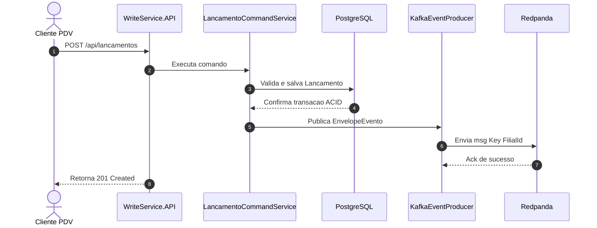
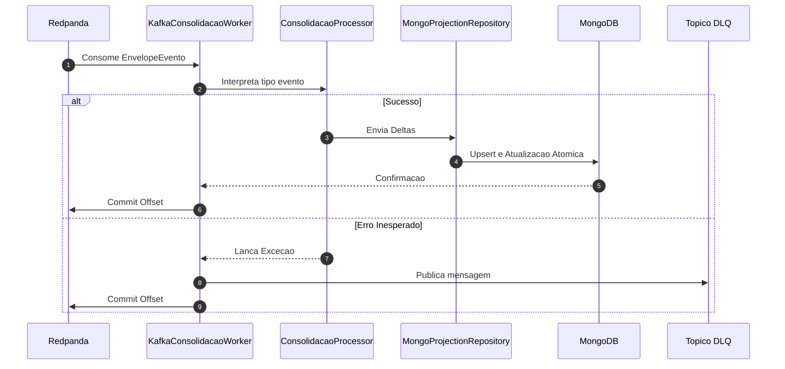
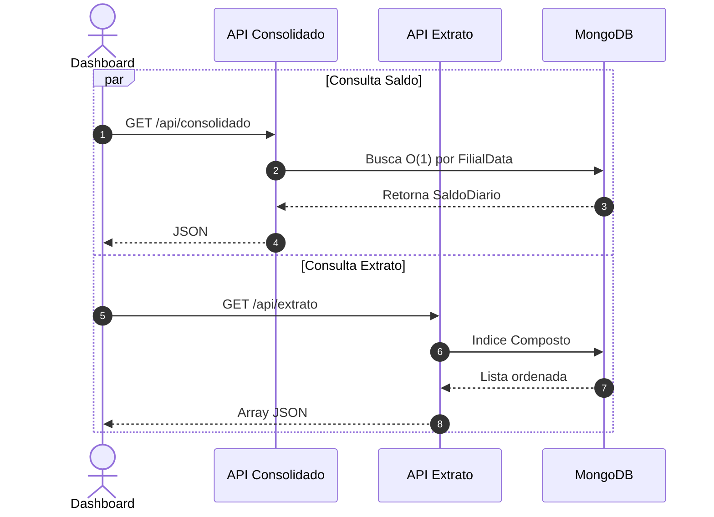

# 🏦 Sistema de Fluxo de Caixa — Banco Carrefour

Arquitetura de microsserviços de alta performance, resiliente, transacional e orientada a eventos para o sistema de fluxo de caixa do **Banco Carrefour**. Desenvolvida sob os mais altos padrões de mercado com **.NET 9 LTS**, **Arquitetura Hexagonal Estrita (Ports & Adapters)**, **DDD**, **CQRS** e mensageria assíncrona com **Redpanda**.

---

## 📐 Decisões Arquiteturais (ADRs)

1. **Arquitetura Hexagonal Estrita:** Isolamento absoluto entre as regras de negócio (Domínio) e os detalhes de infraestrutura (EF Core, MongoDB, Redpanda). A comunicação ocorre exclusivamente através de **Portas (Interfaces)**, garantindo a inversão de dependência e testabilidade pura.
2. **CQRS & Polyglot Persistence:** A escrita prioriza **ACID rigoroso** via PostgreSQL; a leitura prioriza baixa latência e alta volumetria via **MongoDB** (motor WiredTiger com índices compostos), eliminando a necessidade de cache auxiliar (Redis).
3. **Event-Driven com Redpanda:** Desacoplamento temporal através de tópicos particionados por `FilialId`, garantindo ordenação estrita por loja e resiliência via **Dead Letter Queue (DLQ)**.
4. **Segurança Centralizada:** Todos os endpoints são protegidos por um **Middleware de Autenticação** customizado que intercepta e valida os tokens JWT (via Keycloak), injetando o contexto do utilizador de forma limpa nos *Use Cases*.

---

## 📊 Diagramas de Fluxo de Arquitetura

### Fluxo 1: Escrita Transacional (Write Service)
*Garante consistência ACID na gravação do lançamento e publicação imutável do evento.*



---

### Fluxo 2: Processamento Assíncrono (Consolidation Worker)
*Consome eventos em background, calcula deltas matemáticos e atualiza o MongoDB.*



---

### Fluxo 3: Consultas de Leitura Otimizadas (CQRS Read APIs)
*Consultas em milissegundos nas coleções projetadas, sem impacto na base transacional.*



---

## 🧩 Topologia do Monorepo

```text
BancoCarrefour.sln
│
├── src/
│   ├── BuildingBlocks/
│   │   └── BancoCarrefour.EventBus.Contracts  
│   ├── WriteService/
│   │   ├── WriteService.Domain                
│   │   ├── WriteService.Application           
│   │   ├── WriteService.Infrastructure        
│   │   └── WriteService.API                   
│   ├── ConsolidationWorker/
│   │   ├── Worker.Domain                      
│   │   ├── Worker.Application                 
│   │   ├── Worker.Infrastructure              
│   │   └── Worker.Host                        
│   ├── ReadService.Consolidado/
│   │   └── ReadService.Consolidado.API        
│   └── ReadService.Extrato/
│       └── ReadService.Extrato.API            
│
└── tests/
    └── BancoCarrefour.UnitTests               
```

---

## 🚀 Guia de Operação (GitHub Codespaces / Docker)

### 1. Subir o Ecossistema Completo
O repositório inclui um `docker-compose.yml` que orquestra Bases de Dados, Mensageria e todos os Microsserviços em .NET:
```bash
docker-compose up --build -d
```
* **Kafka UI:** Aceda a `http://localhost:8085` para monitorizar eventos.
* **Keycloak:** Aceda a `http://localhost:8080` para gestão de utilizadores e tokens.

### 2. Dados de Teste Automáticos (Seed)
Ao iniciar, o PostgreSQL cadastra automaticamente as seguintes informações para testes rápidos:
* **Filial ID:** `11111111-1111-1111-1111-111111111111` (Carrefour Pinheiros)
* **Filial ID:** `22222222-2222-2222-2222-222222222222` (Carrefour Dom Pedro)
* **Tipo Operação (Crédito):** `33333333-3333-3333-3333-333333333333`
* **Tipo Operação (Débito):** `44444444-4444-4444-4444-444444444444`

### 3. Executando as Aplicações Manualmente (Opcional)
Se preferir rodar fora do Docker para *debug* no terminal:
```bash
dotnet run --project src/WriteService/WriteService.API/WriteService.API.csproj
dotnet run --project src/ConsolidationWorker/Worker.Host/Worker.Host.csproj
dotnet run --project src/ReadService.Consolidado/ReadService.Consolidado.API/ReadService.Consolidado.API.csproj
dotnet run --project src/ReadService.Extrato/ReadService.Extrato.API/ReadService.Extrato.API.csproj
```