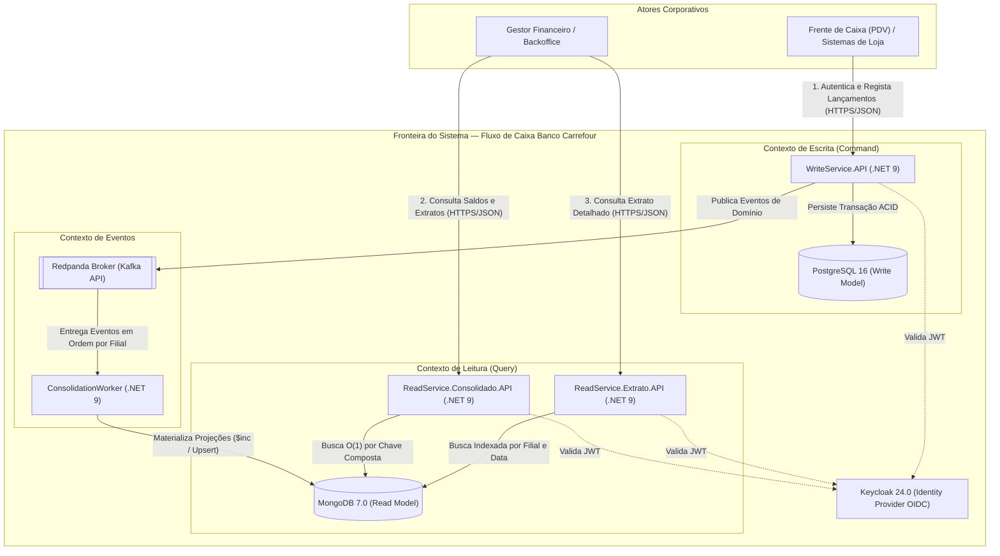

# 🏛️ Documento de Visão Arquitetural (Architecture Vision & ADRs)

Este documento detalha os atributos de qualidade, o modelo C4, as estratégias de resiliência e os **Architecture Decision Records (ADRs)** que fundamentam a solução de Fluxo de Caixa e Consolidação Diária do Banco Carrefour.

---

## 🎯 1. Requisitos Não-Funcionais (RNFs) e Drivers Arquiteturais

| ID | Atributo de Qualidade | Meta / SLA Exigido | Mecanismo Arquitetural Implementado |
| :--- | :--- | :--- | :--- |
| **RNF-01** | **Isolamento de Falhas (Disponibilidade)** | O serviço de lançamento (escrita) não pode sofrer indisponibilidade caso o sistema de consolidação diária caia. | Segregação física via **CQRS + Mensageria Assíncrona (Redpanda)**. O `WriteService` depende apenas do PostgreSQL e do broker, sem comunicação síncrona HTTP/gRPC com o lado de leitura. |
| **RNF-02** | **Throughput em Pico (Performance)** | O serviço de consolidado diário deve suportar picos de **50 requisições por segundo** com no máximo **5% de perda** de requisições. | Pré-agregação contínua em **MongoDB** via `ConsolidationWorker` usando `$inc`. A leitura no `ReadService.Consolidado` resume-se a um *point-lookup* O(1) por `_id` (`FilialId_Data`), respondendo em `< 5ms`. |
| **RNF-03** | **Consistência e Precisão Contábil** | Zero perda de centavos por arredondamento de ponto flutuante e tolerância a reentregas de mensagens. | Uso estrito de `numeric(18,2)` no PostgreSQL e `Decimal128` no MongoDB, aliado a `ReplaceOneAsync (IsUpsert = true)` no extrato para idempotência. |
| **RNF-04** | **Segurança Zero-Trust** | Autenticação e autorização estritas por perfil operacional sem *bypasses* em ambiente de validação. | **Keycloak 24 (OIDC/OAuth2)** integrado via JWT Bearer com validação de assinatura, múltiplos emissores e *Role-Based Access Control* (`writer`, `read`, `admin`). |

---

## 🗺️ 2. Visão de Contexto e Contentores (Modelo C4)

---

## 🧩 3. Design Interno: Arquitetura Hexagonal (Ports & Adapters)

Dentro do `WriteService` e do `ConsolidationWorker`, o código é organizado em anéis concêntricos de dependência (Clean / Hexagonal Architecture):

1. **Domain Layer (`WriteService.Domain` / `Worker.Domain`):**
   * Contém entidades ricas (`Lancamento`), objetos de valor e exceções de negócio (`DomainException`).
   * Define as interfaces de saída (*Outbound Ports*): `ILancamentoRepository`, `IEventProducer` e `IProjectionRepository`. Não possui referência a nenhum pacote de infraestrutura (EF Core, Kafka ou MongoDB).
2. **Application Layer (`WriteService.Application` / `Worker.Application`):**
   * Orquestra os casos de uso (`LancamentoCommandService`, `ConsolidacaoProcessor`) e a transformação de DTOs e Eventos.
3. **Infrastructure & Adapters Layer (`WriteService.Infrastructure` / `Worker.Infrastructure`):**
   * Implementa os *Adapters* secundários: `LancamentoRepository` (EF Core 9 + Npgsql), `KafkaEventProducer`, `KafkaConsolidacaoWorker` (Confluent.Kafka) e `MongoProjectionRepository` (MongoDB.Driver 3.0).
4. **API / Host Layer (`WriteService.API` / `Worker.Host`):**
   * *Primary Adapters*: Minimal APIs, *Middlewares* de contexto de autenticação, configuração de injeção de dependência (DI) e políticas de segurança JWT.

---

## 📋 4. Registo de Decisões de Arquitetura (ADRs)

### ADR-001: Adoção de CQRS com Persistência Poliglota (PostgreSQL + MongoDB)
* **Contexto:** Uma única base relacional submetida simultaneamente a escritas transacionais constantes (PDVs) e agregações analíticas pesadas (`SUM(valor) GROUP BY filial, data`) a 50 req/s sofre contenção de *locks* e degradação de latência.
* **Decisão:** Separar fisicamente o modelo de escrita (**PostgreSQL 16**) do modelo de leitura (**MongoDB 7.0**).
* **Consequências:**
  * *Positivas:* O `ReadService.Consolidado` lê um documento já totalizado em `< 5ms` sem executar `SUM()` em tempo de consulta; queda do MongoDB ou do Worker não afeta o PostgreSQL.
  * *Trade-off:* Consistência eventual (normalmente `< 50ms` entre o `POST` no WriteService e a atualização no MongoDB).

### ADR-002: Redpanda em substituição ao Apache Kafka + ZooKeeper/KRaft tradicional
* **Contexto:** O Apache Kafka tradicional exige JVM pesada, alto consumo de RAM e tempo elevado de inicialização em ambientes containerizados de avaliação.
* **Decisão:** Utilizar **Redpanda v23.3**, um broker 100% compatível com o protocolo Kafka escrito em C++.
* **Consequências:**
  * *Positivas:* Arranque em poucos segundos com apenas 512 MB de RAM, latência *tail* até 10x menor e total compatibilidade com a biblioteca oficial `Confluent.Kafka` no .NET 9.

### ADR-003: Consolidação Atômica no MongoDB via Operador `$inc` e `Decimal128`
* **Contexto:** Se múltiplas instâncias do `ConsolidationWorker` lerem o saldo na memória, somarem em C# e gravarem de volta no banco (*Read-Modify-Write*), ocorrerão condições de corrida (*Race Conditions* / *Lost Updates*).
* **Decisão:** Utilizar operações atômicas nativas do motor WiredTiger do MongoDB (`Update.Inc(x => x.TotalCreditos, deltaCredito).Inc(x => x.SaldoFinal, deltaLiquido)`) armazenadas como `BsonType.Decimal128` e identificadores com `GuidRepresentation.Standard`.
* **Consequências:**
  * *Positivas:* Precisão financeira absoluta e eliminação de *Lost Updates* mesmo sob paralelismo elevado.

### ADR-004: Tratamento de Falhas com Commit Manual de Offset e Dead-Letter Queue (DLQ)
* **Contexto:** Mensagens corrompidas (*Poison Pills*) ou falhas transitórias não podem travar a fila de consolidação nem ser descartadas silenciosamente.
* **Decisão:** Desativar o *auto-commit* do consumidor Kafka (`EnableAutoCommit = false`). O *commit* do *offset* ocorre apenas após a confirmação de escrita no MongoDB. Caso ocorra uma exceção no processamento, o payload original é republicado no tópico `lancamentos-dlq` para auditoria e reprocessamento futuro.

### ADR-005: Segregação do Query Side em Dois Microsserviços (`Consolidado` vs `Extrato`)
* **Contexto:** A consulta de saldo consolidado possui SLA crítico (50 req/s com payload leve de ~200 bytes), enquanto a consulta de extrato detalhado retorna listas extensas de transações do dia.
* **Decisão:** Isolar `ReadService.Consolidado.API` (Porta `5002`) e `ReadService.Extrato.API` (Porta `5003`) em processos e contentores independentes.
* **Consequências:**
  * *Positivas:* Permite escalar horizontalmente (ex.: HPA no Kubernetes) apenas os *pods* do `Consolidado.API` durante picos de fecho de caixa, sem competir por CPU/memória de serialização JSON com relatórios pesados de extrato.

---

## 🚀 5. Roadmap de Evolução para Produção Corporativa (Cloud-Native)

Embora a solução atual atenda integralmente aos requisitos funcionais e não-funcionais do case em ambiente containerizado, o desenho arquitetural prevê três evoluções naturais para operação crítica em larga escala:

1. **Transactional Outbox Pattern (Garantia Dual-Write no WriteService):**
   * *Contexto:* Evitar inconsistência caso o banco PostgreSQL confirme a transação (`Commit`), mas ocorra uma falha de rede exata no milissegundo anterior ao `ProduceAsync` no Redpanda.
   * *Evolução:* Gravar o evento numa tabela `OutboxMessages` na mesma transação ACID do `WriteDbContext` e utilizar um *Relay Worker* ou **Debezium CDC (Change Data Capture)** para publicar no Redpanda.
2. **Observabilidade Distribuída (OpenTelemetry + Prometheus + Grafana):**
   * Instrumentação nativa do .NET 9 via `System.Diagnostics.Activity` propagando o `traceparent` nos cabeçalhos HTTP e nos headers das mensagens Kafka/Redpanda para rastrear a latência fim a fim desde o PDV até a projeção no MongoDB.
3. **Auto-Scaling Orientado a Eventos (KEDA + HPA no Kubernetes):**
   * Escalonamento horizontal automático do `ConsolidationWorker` via **KEDA** com base na métrica de *Consumer Lag* do tópico `lancamentos-eventos`, e escalonamento do `ReadService.Consolidado.API` via **HPA** com base em RPS/CPU.
